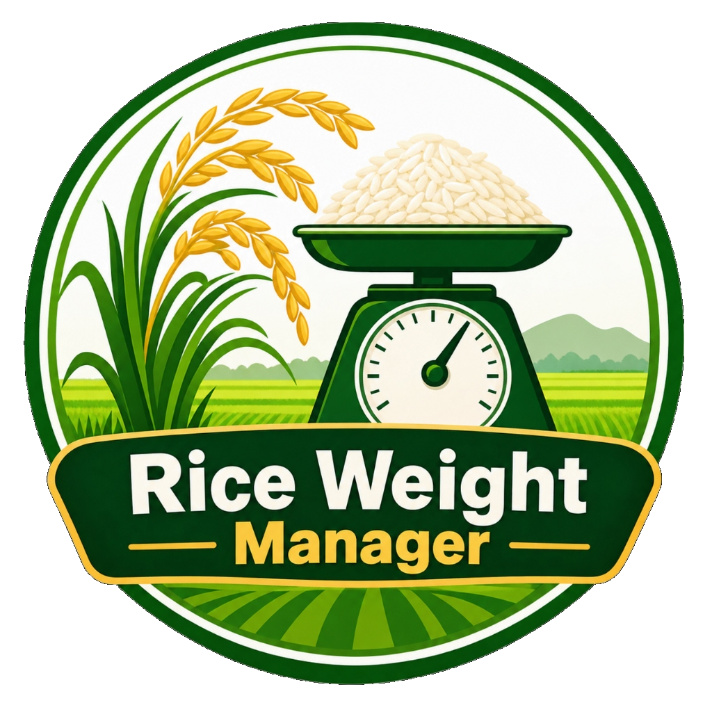
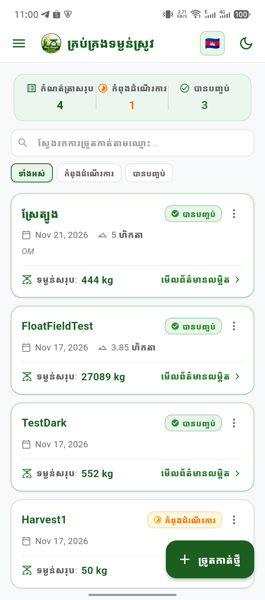
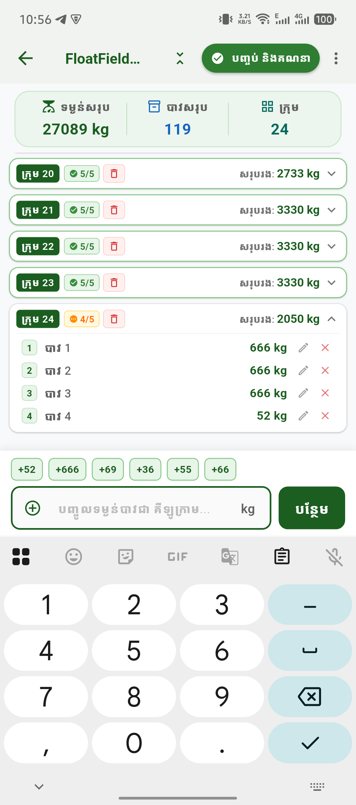
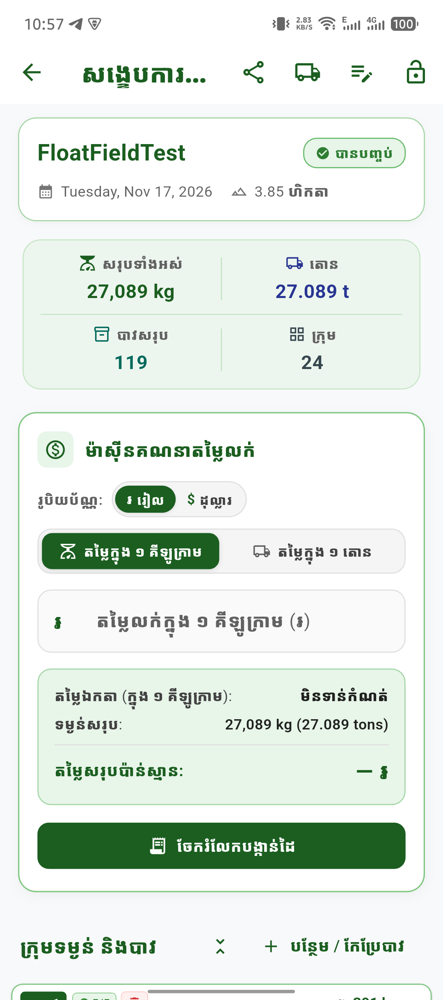
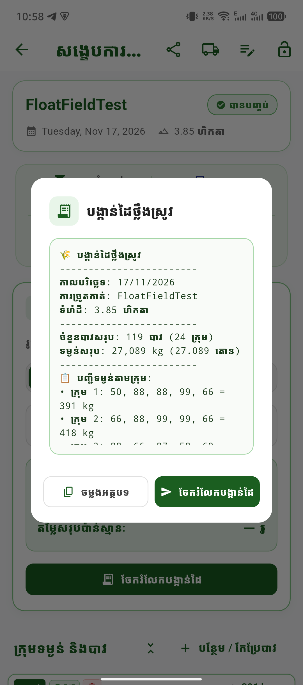
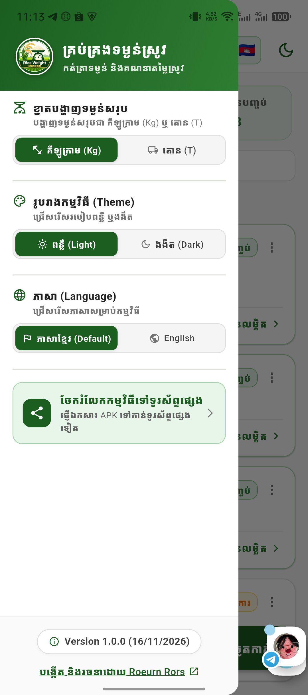

<p align="center">
  
</p>

<h1 align="center">🌾 Rice Weight Manager</h1>
<h3 align="center">កម្មវិធីគ្រប់គ្រងទម្ងន់ស្រូវ និងគណនាតម្លៃលក់</h3>

<p align="center">
  <a href="https://flutter.dev"></a>
  <a href="https://dart.dev"></a>
  <a href="https://sqlite.org"></a>
  <a href="https://www.android.com"></a>
  <a href="https://github.com/Roeurn-007/Rice_weight_manager"></a>
  <a href="https://roeurn.rest/"></a>
</p>

---

## 📖 អំពីកម្មវិធី (Overview)

**Rice Weight Manager** គឺជាកម្មវិធីទូរស័ព្ទដៃដែលបង្កើតឡើងជាពិសេសសម្រាប់កសិករ អ្នកម៉ៅការច្រូតកាត់ និងម្ចាស់រោងម៉ាស៊ីនកិនស្រូវក្នុងប្រទេសកម្ពុជា ដើម្បីកត់ត្រាទម្ងន់បាវស្រូវ គណនាតម្លៃ និងចែករំលែកវិក្កយបត្របានលឿន រហ័ស និងមានសុវត្ថិភាពខ្ពស់បំផុត ដោយដំណើរការ **Offline ១០០%** មិនបាច់ប្រើអ៊ីនធឺណិត។

A modern, fast, and ergonomic mobile application engineered specifically for farmers, harvest contractors, and rice mill operators to record sack weights, calculate revenue, and share professional receipts instantly.

---

## 📸 រូបភាពបង្ហាញពីដំណើរការកម្មវិធី (App Screenshots)

<div align="center">

| អេក្រង់ដើម (Home Dashboard) | បញ្ចូលទម្ងន់បាវ (Weight Entry) | គណនាតម្លៃលក់ (Pricing & Value) |
| :---: | :---: | :---: |
|  |  |  |
| *បង្ហាញស្ថិតិ និងបញ្ជីការច្រូតកាត់* | *ក្រុម ៥ បាវ, Quick Chips និងគ្មាន Popup* | *គណនាថ្លៃស្រូវជារៀល/ដុល្លារ តាមគីឡូ/តោន* |

<br />

| វិក្កយបត្រថ្លឹងស្រូវ (Instant Receipt) | ផ្ទាំងការកំណត់ & Link អ្នកបង្កើត (Settings Drawer) |
| :---: | :---: |
|  |  |
| *បង្កាន់ដៃស្អាត មិនធ្លាក់បន្ទាត់ ត្រៀម Share ទៅ Telegram* | *ប្តូរភាសា, Theme និង Link ទៅកាន់គេហទំព័រ Roeurn Rors* |

</div>

---

## ✨ មុខងារចម្បងៗ (Key Features)

- ⚡ **ការបញ្ចូលទម្ងន់លឿនឥតទាក់ (High-Speed Data Entry):**
  - **Quick Weight Chips ឆ្លាតវៃ:** បង្ហាញលេខទម្ងន់ដែលធ្លាប់បញ្ចូលញឹកញាប់ និងថ្មីៗដោយស្វ័យប្រវត្តិ។
  - **គ្មានសាររំខាន (No Popup Overlay):** គ្មានផ្ទាំង SnackBar មកបាំងអេក្រង់ពេលបញ្ចូលបាវ អាចចុចបន្ថែមបាវជាប់ៗគ្នាយ៉ាងលឿន។
- 📦 **ការរៀបចំក្រុមបាវតាមស្តង់ដារកម្ពុជា (Standard 5-Sack Grouping):**
  - បែងចែកបាវស្រូវជាក្រុមៗ (១ ក្រុម = ៥ បាវ) ព្រមទាំងគណនាសរុបតាមក្រុម (`Subtotal`) និងសរុបរួម (`Grand Total`) ជាគីឡូក្រាម (kg) និងតោន (Metric Tons) ដោយស្វ័យប្រវត្តិ។
  - មុខងារបិទ/ពង្រីកក្រុម (Collapse/Expand) ឬ Auto-Collapse នៅពេលក្រុមពេញ ៥ បាវ ដើម្បីឱ្យអេក្រង់ស្រឡះងាយស្រួលមើល។
- 🌾 **គាំទ្រទំហំដីជាចំនួនទសភាគ (Decimal Hectare Support):**
  - អាចបញ្ចូលទំហំដីស្រែជាហិកតាដែលមានលេខក្បៀស (ឧទាហរណ៍៖ `3.85 ហិកតា`, `5.5 Hectares`)។
- 💰 **ម៉ាស៊ីនគណនាតម្លៃលក់ចម្រុះ (Flexible Price & Revenue Calculator):**
  - គណនាប្រាក់ចំណូលបានទាំងជា **ប្រាក់រៀល (KHR ៛)** ឬ **ប្រាក់ដុល្លារ (USD $)**។
  - កំណត់តម្លៃលក់តាម **១ គីឡូក្រាម** ឬ **១ តោន (1,000 kg)** ជាមួយប្រព័ន្ធបំប្លែងស្វ័យប្រវត្តិ។
- 🧾 **ចែករំលែកវិក្កយបត្រ/បង្កាន់ដៃថ្លឹងស្រូវ (Instant Receipt Sharing):**
  - បង្កើតវិក្កយបត្រស្អាត មានរបៀប មានបន្ទាត់ខណ្ឌត្រឹមត្រូវមិនធ្លាក់បន្ទាត់ សម្រាប់ចម្លង (Copy) ឬផ្ញើផ្ទាល់ (Share) ទៅកាន់ **Telegram**, **WhatsApp**, ឬសារ SMS។
- 🌐 **ភាសាខ្មែរ និងអង់គ្លេសពេញលេញ (Khmer & English Bilingual):**
  - ផ្លាស់ប្តូរភាសាបានភ្លាមៗដោយគ្រាន់តែចុចលើទង់ជាតិលើរបារខាងលើ។
- 🌙 **គាំទ្រ Dark Mode & Light Mode:**
  - រូបរាងភ្លឺច្បាស់សម្រាប់ពេលថ្ងៃនៅវាលស្រែ និងរូបរាងងងឹត (Dark Mode) សន្សំថ្ម និងមិនចាំងភ្នែកពេលយប់។
- 🚀 **ដំណើរការលឿនជាមួយ SQLite B-Tree Indexing:**
  - ផ្ទុកទិន្នន័យបានរាប់ពាន់ Harvests និងរាប់លានបាវ ដោយស្វែងរកក្នុងកម្រិត **`O(log N)` ត្រឹម ១ ទៅ ២ មីលីវិនាទី** មិនធ្វើឱ្យទូរស័ព្ទយឺតឡើយ។
- 🔒 **សុវត្ថិភាព និងភាពឯកជន ១០០% (Offline & Privacy First):**
  - មិនមានការប្រមូលទិន្នន័យ គ្មានមេរោគ គ្មាន Ads និងមិនទាមទារសិទ្ធិគ្រោះថ្នាក់លើទូរស័ព្ទ។

---

## 🛠️ បច្ចេកវិទ្យាដែលបានប្រើប្រាស់ (Tech Stack)

- **Framework:** [Flutter](https://flutter.dev) (Dart 3.x)
- **Database:** [SQLite](https://sqlite.org) (`sqflite`) ជាមួយ Custom B-Tree Indexes
- **Formatting & Localization:** `intl` package
- **Native Android Integration:** Kotlin (MethodChannel for Native Sharing & URL Intent Launching)
- **Target OS:** Android 5.0 (API 21) ដល់ Android 15+ (API 35+)

---

## 📱 របៀបដំឡើង និងដំណើរការ Project (Getting Started)

### លក្ខខណ្ឌតម្រូវ (Prerequisites)
- [Flutter SDK](https://docs.flutter.dev/get-started/install) (version 3.13 ឬខ្ពស់ជាងនេះ)
- Android Studio / Android SDK
- Java JDK 17+

### ជំហានដំឡើង (Installation Steps)

1. **Clone repository នេះមកកាន់កុំព្យូទ័រ៖**
   ```bash
   git clone https://github.com/Roeurn-007/Rice_weight_manager.git
   cd Rice_weight_manager
   ```

2. **ទាញយក Packages/Dependencies៖**
   ```bash
   flutter pub get
   ```

3. **ដំណើរការ App លើទូរស័ព្ទ ឬ Emulator៖**
   ```bash
   flutter run
   ```

4. **Build ឯកសារ APK សម្រាប់ដំឡើងលើទូរស័ព្ទ (Release APK)៖**
   ```bash
   flutter build apk --release
   ```
   ឯកសារ APK នឹងស្ថិតនៅ៖ `build/app/outputs/flutter-apk/app-release.apk`

---

## 📂 រចនាសម្ព័ន្ធ Project (Project Structure)

```text
lib/
├── main.dart                      # ចំណុចចាប់ផ្តើមនៃកម្មវិធី (App Entry Point)
├── models/
│   ├── harvest.dart               # Model សម្រាប់កំណត់ត្រាការច្រូតកាត់ (Harvest)
│   ├── weight_group.dart          # Model សម្រាប់ក្រុមបាវ (Group of 5 sacks)
│   └── weight_entry.dart          # Model សម្រាប់ទម្ងន់បាវនីមួយៗ (Individual sack weight)
├── screens/
│   ├── home_screen.dart           # អេក្រង់ដើម បង្ហាញបញ្ជីការច្រូតកាត់ និងស្ថិតិ
│   ├── harvest_form_screen.dart   # អេក្រង់បង្កើត/កែប្រែការច្រូតកាត់ (ឈ្មោះ, កាលបរិច្ឆេទ, ហិកតា)
│   ├── weight_entry_screen.dart   # អេក្រង់បញ្ចូលទម្ងន់បាវ (Quick chips, groups, subtotal)
│   └── harvest_detail_screen.dart # អេក្រង់សង្ខេប, គណនាតម្លៃលក់ និងចែករំលែកវិក្កយបត្រ
├── services/
│   ├── database_service.dart      # សេវាគ្រប់គ្រង SQLite Database, Queries & Indexes
│   └── app_settings_service.dart  # សេវាគ្រប់គ្រងភាសា, Theme, Units, Currency & Native Channels
└── widgets/
    ├── harvest_card.dart          # Card បង្ហាញទិន្នន័យការច្រូតកាត់នីមួយៗ
    └── settings_drawer.dart       # ផ្ទាំងការកំណត់ (Settings Drawer & Developer Credit Link)
```

---

## 👨‍💻 អ្នកបង្កើត និងរចនា (Author & Developer)

* **បង្កើត និងរចនាដោយ:** **Roeurn Rors**
* **គេហទំព័រផ្ទាល់ខ្លួន (Website):** [https://roeurn.rest/](https://roeurn.rest/)
* **GitHub Profile:** [@Roeurn-007](https://github.com/Roeurn-007)

---

## 📄 អាជ្ញាប័ណ្ណ (License)

Project នេះត្រូវបានបង្កើតឡើងសម្រាប់ជាប្រយោជន៍ដល់កសិករ និងសហគមន៍កសិកម្មនៅកម្ពុជា។ រក្សាសិទ្ធិគ្រប់យ៉ាងដោយ **Roeurn Rors**។
